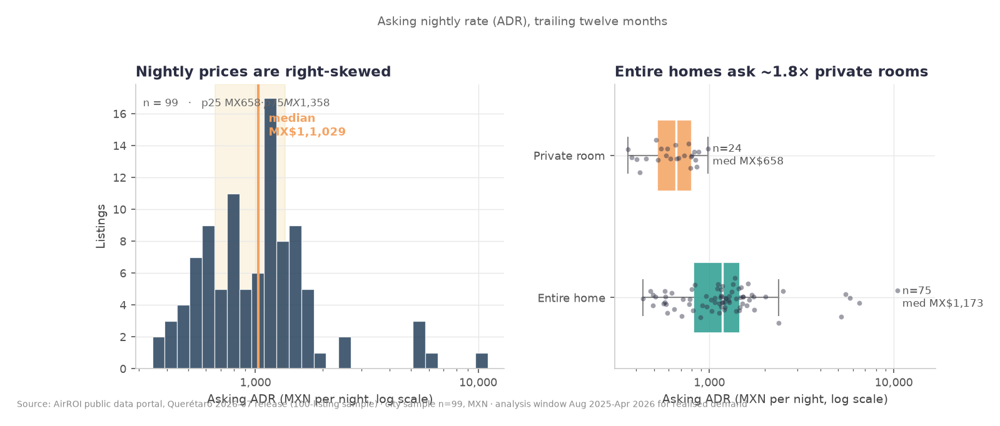
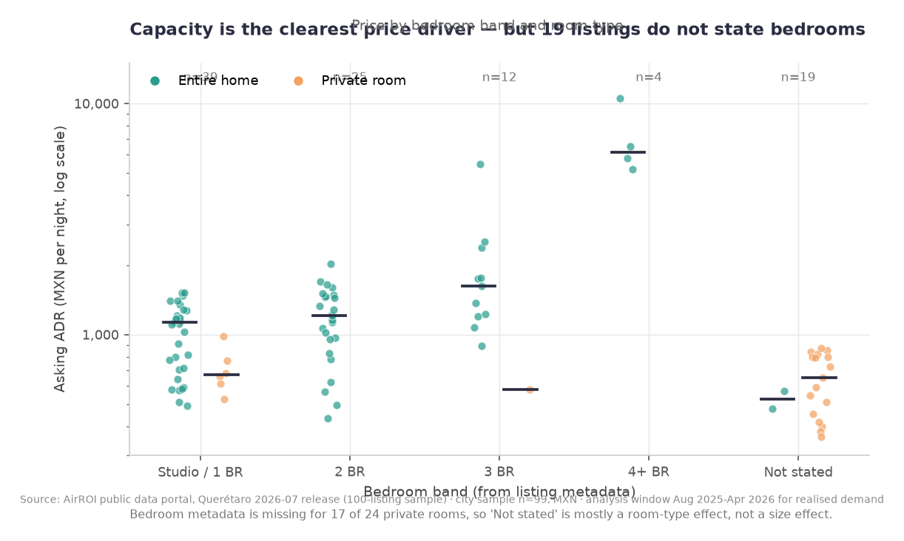
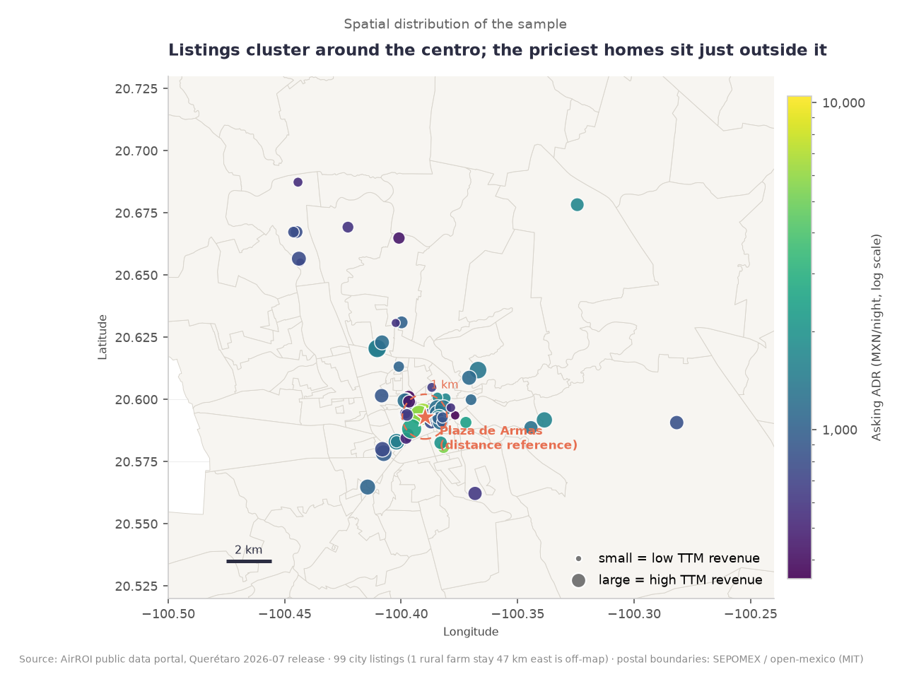
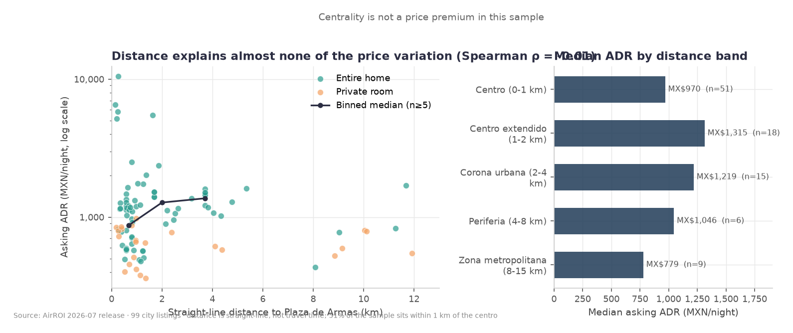
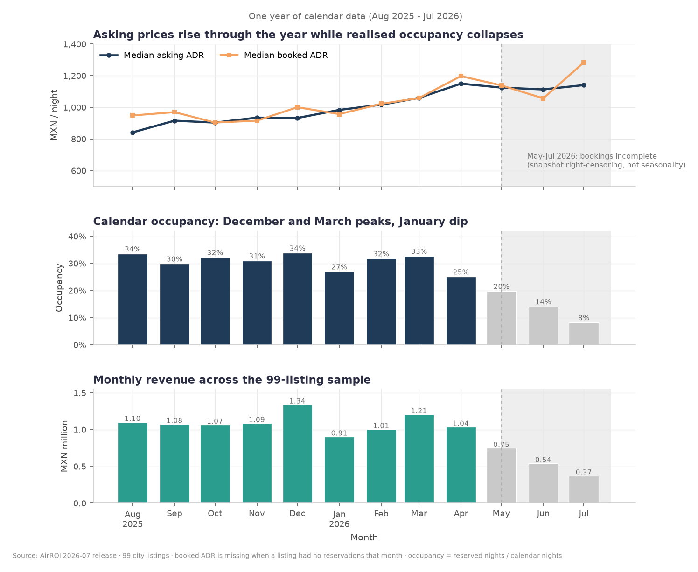
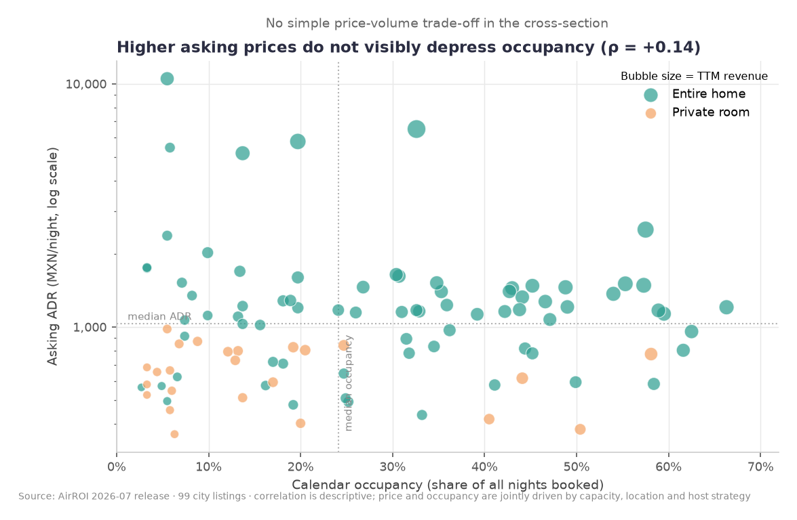
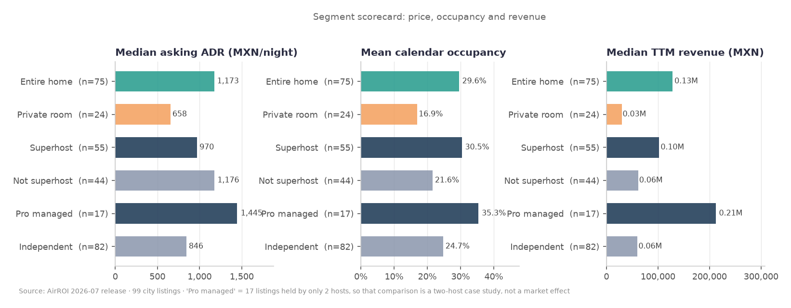
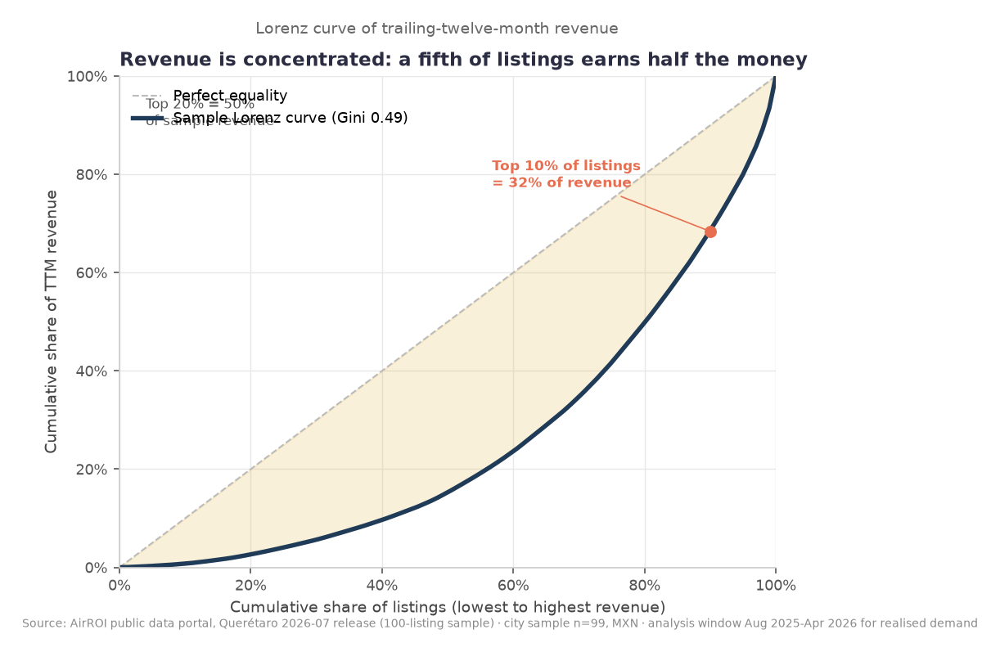
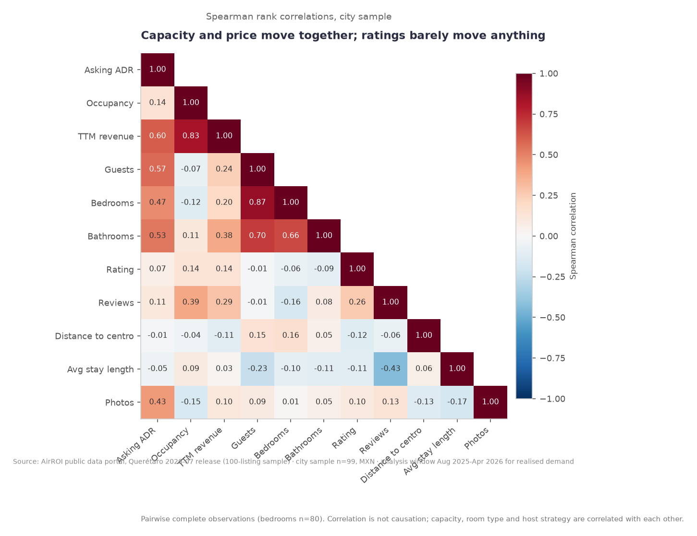
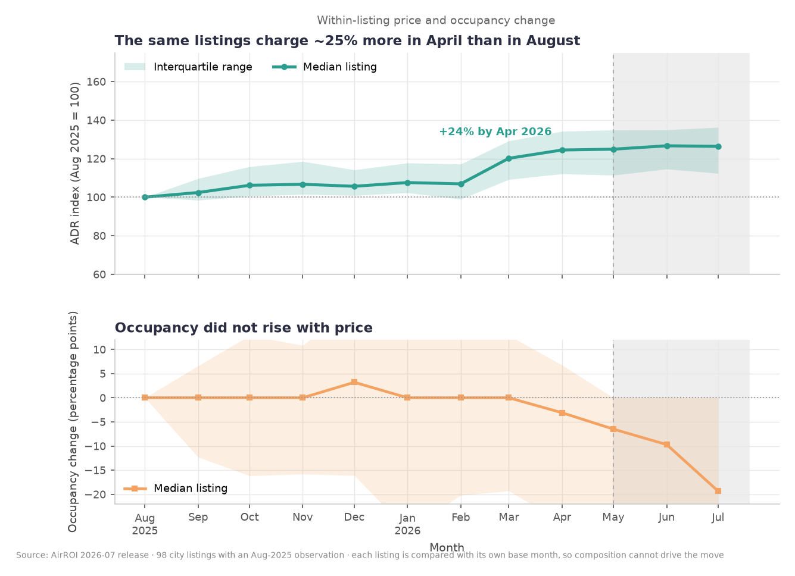

# Executive business report: Santiago de Querétaro short-term rentals

_Generated by `src/generate_business_report.py` on 2026-10-25T19:19:44+00:00 from `airbnb_queretaro.db` and `reports/key_metrics.json`. Every number below is reproduced by `python src/run_all.py`._

**Source:** AirROI Data Portal, Querétaro, Mexico, release 2026-07 (downloaded 2026-10-25, CC BY-NC 4.0). **Coverage:** 100 sampled listings over 12 months (Aug 2025 - Jul 2026), of which 99 sit inside the 15 km city core and form the analysis base. **Currency:** MXN. **Scope of every figure in this report:** the city sample, not the whole market.

## Executive summary

The analysis covers **99 city listings run by 50 hosts** (51 hosts across all 100 sampled listings; one rural farm stay 47 km from the centro is excluded from city statistics). Median asking price is **MX$1,029 per night**, median calendar occupancy is **24.1%**, and median trailing-twelve-month revenue is **MX$87,335 per listing**, for a sample total of **MX$11,995,861**.

The commercial picture is uneven. **92.2% of sample revenue comes from entire homes**, which are 75.8% of the listings, while revenue is concentrated overall (Gini 0.488; the top 10% of listings earn 31.6%). Asking prices rose a median +24.5% between Aug 2025 and Apr 2026 while occupancy did not follow, and price level is not what limits occupancy (rho = +0.14). Seasonality is shallow: one December peak, about 8.8 percentage points between the best and worst month.

**Action priority.** 5 recommendations were generated from 6 triggered rules, ordered by a documented score (half rule weight, half measured evidence strength). The two with the largest measured effect are *introduce capacity-based rate bands and test them on comparable units* and *run a controlled repricing test instead of assuming price drives occupancy*. Every recommendation is an experiment to run, not a conclusion about causes: the data is observational, contains no cost information and no booking-level records, and covers about 6% of the market.

## Key performance indicators

All values are computed from `v_city_listings` and `v_monthly_market` in `airbnb_queretaro.db`. Occupancy is **calendar occupancy** (reserved nights divided by all calendar nights in the period, including host-blocked nights) unless a row says otherwise. Revenue is **trailing-twelve-month revenue as reported by the provider**, not profit and not gross booking value.

| KPI | Value | Unit | Period | Definition | n |
|---|---:|---|---|---|---:|
| Listings analyzed | 99 | listings | Aug 2025 - Jul 2026 | Listings inside the 15 km city-core scope (100 sampled in total, 1 rural excluded) | 99 |
| Hosts in the city sample | 50 | hosts | Aug 2025 - Jul 2026 | Distinct hosts behind the analysed listings | 99 |
| Median asking ADR | MX$1,029 | MXN / night | Snapshot 2026-07 | Listing-level nightly asking price, median (95% bootstrap CI MX$832 - MX$1,160) | 99 |
| Mean asking ADR | MX$1,303 | MXN / night | Snapshot 2026-07 | Arithmetic mean; above the median because of a right-skewed tail | 99 |
| Median calendar occupancy | 24.1% | % of nights | Aug 2025 - Jul 2026 | Reserved nights / all calendar nights (95% bootstrap CI 18.1% - 31.5%) | 99 |
| Median occupancy net of host blocks | 27.8% | % of nights | Aug 2025 - Jul 2026 | Reserved nights / nights actually open for sale | 99 |
| Median TTM revenue per listing | MX$87,335 | MXN / listing | Trailing 12 months to 2026-07 | Provider-reported revenue, median (95% bootstrap CI MX$54,273 - MX$116,516) | 99 |
| Total sample revenue | MX$11,995,861 | MXN | Trailing 12 months to 2026-07 | Sum of listing revenue in the city sample; not a market total | 99 |
| Median RevPAR | MX$233 | MXN / available night | Trailing 12 months to 2026-07 | Revenue divided by nights available for sale | 99 |
| Revenue concentration (Gini) | 0.488 | index 0-1 | Trailing 12 months | Inequality of listing revenue: 0 = equal, 1 = one listing takes everything | 99 |
| Top 10% / 20% of listings' revenue share | 31.6% / 50.5% | % of sample revenue | Trailing 12 months | Share of revenue taken by the highest-earning decile / quintile | 99 |
| Largest single host | 11 listings, 18.9% of revenue | listings / % | Trailing 12 months | Most listings operated by one host in the sample | 99 |
| Entire home: share of listings / revenue | 75.8% / 92.2% | % | Trailing 12 months | Median ADR MX$1,173, median occupancy 30.7%, median revenue MX$128,135 | 75 |
| Private room: share of listings / revenue | 24.2% / 7.8% | % | Trailing 12 months | Median ADR MX$658, median occupancy 12.5%, median revenue MX$30,492 | 24 |
| Listings within 1 km of Plaza de Armas | 51.5% | % of listings | Snapshot 2026-07 | Straight-line distance, the location proxy used because the data has no neighbourhood field | 99 |

### Monthly trend (12-month window)

| Month | Listings with bookings | Calendar occupancy | Median quoted ADR | Median booked ADR | Revenue | Observation |
|---|---:|---:|---:|---:|---:|---|
| Aug 2025 | 75 | 33.6% | MX$842 | MX$949 | MX$1,104,260 | complete |
| Sep 2025 | 72 | 29.9% | MX$916 | MX$970 | MX$1,077,486 | complete |
| Oct 2025 | 75 | 32.3% | MX$904 | MX$904 | MX$1,067,247 | complete |
| Nov 2025 | 77 | 31.0% | MX$935 | MX$916 | MX$1,089,135 | complete |
| Dec 2025 | 79 | 33.9% | MX$933 | MX$1,001 | MX$1,342,015 | complete |
| Jan 2026 | 68 | 27.0% | MX$984 | MX$958 | MX$905,670 | complete |
| Feb 2026 | 72 | 31.9% | MX$1,017 | MX$1,022 | MX$1,006,751 | complete |
| Mar 2026 | 73 | 32.8% | MX$1,060 | MX$1,059 | MX$1,209,558 | complete |
| Apr 2026 | 70 | 25.1% | MX$1,150 | MX$1,198 | MX$1,037,661 | complete |
| May 2026 | 58 | 19.8% | MX$1,125 | MX$1,139 | MX$748,929 | censored (partial window) |
| Jun 2026 | 55 | 14.1% | MX$1,114 | MX$1,057 | MX$543,209 | censored (partial window) |
| Jul 2026 | 44 | 8.3% | MX$1,141 | MX$1,284 | MX$373,273 | censored (partial window) |

**Censoring.** The last 3 months (May 2026, Jun 2026, Jul 2026) are incomplete in the source snapshot - monthly review volume falls 101 -> 73 -> 25 -> 6 across the last four months - so their low occupancy and revenue are an artefact of the cut-off, not demand. Every realised-demand statement in this report uses the 9 complete months (Aug 2025 - Apr 2026).

## Visualisations

### Where asking prices actually sit

*The asking-price distribution is wide and right-skewed: a MX$1,029 median with a MX$1,303 mean means a small number of expensive listings pull the average up, so medians carry the argument in this report.*

### Capacity as the visible price driver

*Price rises with the number of guests a listing accepts, which is the clearest price signal in the sample (rho = +0.57 with guest capacity).*

### Where the sampled listings are

*Sampled listings against the SEPOMEX postal polygons and the distance bands around Plaza de Armas. Coordinates are approximate or unknown for 60 of the 99 city listings, so this is a location proxy, not a neighbourhood map.*

### No detectable distance-price gradient

*Asking price against distance from the centro: no monotonic pattern, consistent with rho = -0.013 (p = 0.90).*

### Monthly price, occupancy and revenue

*Monthly market behaviour for the full 12-month window. The last three months are right-censored by the data snapshot and are excluded from realised-demand claims.*

### Price level does not explain occupancy

*Asking ADR against calendar occupancy: the cloud is flat (rho = +0.14, p = 0.16), so empty listings are not empty because they are expensive.*

### Segment scorecard

*Price, occupancy and revenue for the observable segments (room type, superhost, professional management, capacity bands).*

### Revenue concentration

*Lorenz curve of listing revenue: the top decile of listings takes a disproportionate share of sample revenue (Gini 0.49).*

### Correlation structure

*Spearman correlations between price, occupancy, capacity, rating, reviews and distance. Revenue tracks occupancy (rho = +0.83) far more strongly than price does.*

### Within-listing repricing

*Each listing indexed to its own August 2025 ADR, which removes composition effects: asking prices climb through April while occupancy flattens.*

## Business findings

**F1. Property type drives the revenue split, far more than anything else.** Entire homes are 75.8% of the sampled listings but 92.2% of sample revenue. Median ADR is 1.78x a private room and median revenue is 4.20x, because entire homes win on price and on occupancy.

*Evidence:* q02_room_type_performance; Mann-Whitney p = 5.5e-07, Cliff's delta = 0.68 on revenue (n = 75 vs 24).

**F2. Capacity is the clearest visible price driver.** ADR correlates with guest capacity at rho = +0.57 and with bedrooms at rho = +0.47 (n = 80). Price per guest is U-shaped: studios about MX$458 per guest against about MX$292 for 2-bedroom units.

*Evidence:* q09_bedroom_band_performance; Spearman correlations in src/analyze.py.

**F3. No location premium is detectable in this sample.** Distance to Plaza de Armas correlates with ADR at rho = -0.013 (p = 0.90, n = 99), while 51.5% of listings sit within 1 km. The correct statement is that this dataset cannot identify a location premium.

*Evidence:* q06_distance_band_performance; 60 of 99 city listings have approximate or unknown coordinates, so the location proxy is weak by construction.

**F4. Price level is not what limits occupancy.** ADR and occupancy move almost independently (rho = +0.14, p = 0.16), while revenue and occupancy are tightly linked (rho = +0.83). Occupancy ranges from 9.9% to 42.4% across the middle half of listings with little price difference.

*Evidence:* q03_listing_level_distribution; correlations in src/analyze.py.

**F5. Asking prices rose into flat demand.** 93.9% of the 98 listings present in both months raised their asking ADR between Aug 2025 and Apr 2026, median +24.5%, while median monthly calendar occupancy moved -3.1 pp.

*Evidence:* src/analyze.py within-listing block (paired, so composition effects are removed); q04_monthly_seasonality for the market view.

**F6. Revenue is concentrated in a small share of listings and hosts.** Gini 0.488; the top 10% of listings earn 31.6% of sample revenue and the top 20% earn 50.5%. The largest host operates 11 listings and takes 18.9% of revenue; the professional-management flag covers 17 listings run by 2 hosts.

*Evidence:* q10_revenue_concentration, q11_host_concentration, q08_professional_management.

**F7. Seasonality is real but shallow, with a single December peak.** Occupancy peaks at 33.9% in Dec 2025 and troughs at 25.1% in Apr 2026 - a spread of 8.8 percentage points - while the median quoted ADR climbs steadily across the same months.

*Evidence:* q04_monthly_seasonality over the 9 uncensored months; q16_censoring_evidence shows the last three months are right-censored.

**F8. The evidence base has structural gaps that limit what can be concluded.** 20 of 99 city listings lack a bedroom or guest count (19 without bedrooms, 19 without guest capacity), 60 have inexact or unknown coordinates, one listing has only 7 months of history, and monthly review volume collapses from 101 to 6 across the last four months of the snapshot, which censors the tail months rather than describing demand.

*Evidence:* data_quality.json (24 checks), q16_censoring_evidence, q15_robustness_scope.

## Recommended actions

5 recommendations are published, generated by rules in `src/generate_business_report.py` and ordered by `priority_score = 0.5 x rule weight + 0.5 x evidence strength`. Thresholds are analytical heuristics, not statistical tests; each is stated with the rule so a reviewer can change it. Confidence refers to the pattern inside this sample, never to the wider market.

### 1. Introduce capacity-based rate bands and test them on comparable units

- **Finding:** Capacity is the strongest visible price driver in the sample: asking ADR correlates with guest capacity at rho = +0.57 and with bedrooms at rho = +0.47 (n = 80).
- **Supporting evidence:** Spearman rho(ADR, guests) = +0.566 (p = < 0.0001, n = 80); rho(ADR, bedrooms) = +0.474 (p = < 0.0001, n = 80); price per guest is U-shaped (q09_bedroom_band_performance: studios about MX$458 per guest, 2-bedroom units about MX$292).
- **Business implication:** If the capacity relationship holds, flat per-listing rates leave money on the table for large units and ask too much of small ones. It is an association between capacity and price, not proof of what a given guest would pay.
- **Recommended next action:** Build three rate bands (1-2 guests, 3-4 guests, 5+ guests) from current ADR per guest, apply them to half of the comparable listings for 8 weeks and compare occupancy and realised ADR with the remaining listings.
- **KPI to monitor:** ADR per guest and per bedroom, occupancy, and revenue per available night, by capacity band.
- **Confidence:** Medium - 19% of the sample lacks a field this rule depends on; association only: no causal identification (rubric score 50/100). Priority score 87.2 (rule weight 80, evidence strength 94.3).
- **Limitations / information still required:** 19% of the city sample has no bedroom or guest count, so the relationship is estimated on the listings that do. Capacity is confounded with room type, location and quality, and no booking-level data exists to separate them.
- **Traceability:** rule `capacity_price_signal`, threshold: |Spearman rho| between asking ADR and guest capacity of at least 0.40 (and at least 0.30 for bedrooms) on at least 30 listings with capacity metadata. Observed: rho(ADR, guests) = +0.566 (threshold >= 0.40), rho(ADR, bedrooms) = +0.474 (threshold >= 0.30), n = 80 (threshold >= 30). Queries: q09_bedroom_band_performance, q02_room_type_performance.

### 2. Run a controlled repricing test instead of assuming price drives occupancy

- **Finding:** 93.9% of listings raised their asking ADR between Aug 2025 and Apr 2026 (median +24.5%), while median calendar occupancy over the same window moved -3.1 pp.
- **Supporting evidence:** Within-listing paired change over 98 listings present in both months (src/analyze.py, within_listing): median ADR +24.5%, 93.9% raising; median occupancy change Apr-2026 vs Aug-2025 -3.1 pp (p25 -25.8 pp, p75 +6.8 pp). Across listings, ADR vs occupancy is rho = +0.14 (p = 0.16, n = 99), so the price level itself does not explain occupancy.
- **Business implication:** Asking prices rose while the number of nights sold did not follow. That is a signal to test elasticity, not proof that higher prices reduced demand: the same window also contains normal seasonal pricing.
- **Recommended next action:** Pick 10-15 listings that are similar in capacity, distance band and room type; reduce the asking rate by about 10% on half of them for 6-8 weeks while holding availability and minimum nights unchanged; compare realised ADR, occupancy and revenue per available night against the untouched control listings.
- **KPI to monitor:** Realised (booked) ADR, calendar occupancy and RevPAR per listing, measured weekly for the test window against the control group.
- **Confidence:** Medium - association only: no causal identification (rubric score 75/100). Priority score 85.8 (rule weight 90, evidence strength 81.6).
- **Limitations / information still required:** Association, not causation: a 9-month window cannot separate repricing from seasonal pricing, the sample is ~99 listings, the tail months are right-censored, and no cost data exists, so revenue cannot be translated into profit.
- **Traceability:** rule `pricing_repricing_divergence`, threshold: Within-listing median asking-ADR change of at least +15% between Aug 2025 and Apr 2026 *and* median calendar occupancy falling by at least 1.0 percentage point over the same window. Observed: median ADR change +24.5% (threshold >= 15%), median occupancy change -3.1 pp (threshold <= -1 pp). Queries: q04_monthly_seasonality, q03_listing_level_distribution.

### 3. Profile the top decile and test whether its recipe can be replicated

- **Finding:** Sample revenue is concentrated: Gini 0.488, the top 10% of listings earn 31.6% of revenue and the top 20% earn 50.5%. The largest single host runs 11 listings and takes 18.9% of revenue.
- **Supporting evidence:** Gini 0.488; top-10% share 31.6%, top-20% share 50.5% (q10_revenue_concentration, src/analyze.py concentration); largest host 11 listings = 18.9% of sample revenue (q11_host_concentration). The professional-management flag covers 17 listings run by 2 hosts.
- **Business implication:** A portfolio that depends on a handful of listings and hosts is exposed to the loss of any one of them, and the usual planning assumption (steady median performance) will understate the risk.
- **Recommended next action:** Take the top-decile listings as a case study: record what they share (capacity, rating, superhost status, management, distance band, length of stay), then replicate the two or three cheapest attributes on three to five mid-tier listings and track whether their revenue per available night converges.
- **KPI to monitor:** Revenue share held by the top decile of listings, median revenue of the replication cohort, and the number of hosts operating five or more listings.
- **Confidence:** High - direct measurement on the city sample (rubric score 100/100). Priority score 83.1 (rule weight 85, evidence strength 81.3).
- **Limitations / information still required:** The concentration measurement is exact for this sample but the sample is ~6% of the market, so market-level concentration is not established. The top decile contains very few distinct hosts, and the professional-management comparison rests on two hosts.
- **Traceability:** rule `revenue_concentration`, threshold: Gini coefficient of listing revenue at or above 0.40, or the top 10% of listings earning at least 30% of sample revenue. Observed: Gini 0.488 (threshold >= 0.40), top-10% share 31.6% (threshold >= 30%). Queries: q10_revenue_concentration, q11_host_concentration, q08_professional_management.

### 4. Complete the listing metadata before scaling capacity- or location-based pricing

- **Finding:** The evidence base is incomplete: 20 of 99 city listings (20.2%) lack a bedroom count or a guest count (19 lack bedrooms, 19 lack guest capacity), 61% have inexact or unknown coordinates, and 1 listing has a partial booking history.
- **Supporting evidence:** Capacity fields missing for 20 listings (19 without bedrooms, 19 without guests); coordinates approximate for 54 and unknown for 6; 1 listing with fewer than 12 months of history (q15_robustness_scope, data_quality.json); monthly review volume falls 101 -> 73 -> 25 -> 6 across the last four months (q16_censoring_evidence), so 3 months are right-censored.
- **Business implication:** Capacity-based and location-based rate rules are estimated on a subset of the portfolio, and the last three months of the snapshot cannot be read as demand. Decisions taken on incomplete data can punish listings for missing metadata rather than weak performance.
- **Recommended next action:** Before rolling out capacity bands, backfill bedrooms and guest capacity for the listings that lack them and obtain exact coordinates where the provider allows; keep using only the uncensored window for demand decisions and mark the censored months as such in every report.
- **KPI to monitor:** Share of listings with complete capacity metadata, share of listings with exact coordinates, and the month-by-month review-completeness ratio used to flag censoring.
- **Confidence:** High - direct measurement on the city sample (rubric score 100/100). Priority score 82.9 (rule weight 85, evidence strength 80.8).
- **Limitations / information still required:** The gaps are measured directly, but the remedy depends on provider access and cannot be validated inside this snapshot. No booking-level records are available, so realised demand can only be proxied by reserved nights and review counts.
- **Traceability:** rule `data_completeness_prerequisite`, threshold: At least 15% of listings missing the capacity fields a rate rule depends on, at least 50% of listings with inexact coordinates, or any listing with a partial booking history. Observed: missing capacity 20.2% (threshold >= 15%), inexact/unknown coordinates 61% (threshold >= 50%), partial-history listings 1. Queries: q15_robustness_scope, q16_censoring_evidence, q03_listing_level_distribution.

### 5. Test a December rate plan against a shoulder-season availability plan

- **Finding:** Demand peaks once and mildly: Dec 2025 occupancy 33.9% against Apr 2026 25.1% (8.8 pp), and Dec 2025 revenue MX$1,342,015 is 25% above the median month.
- **Supporting evidence:** v_monthly_market over the uncensored window Aug 2025 - Apr 2026 (9 months, q04_monthly_seasonality): peak occupancy 33.9% in Dec 2025, trough 25.1% in Apr 2026, median quoted ADR rising from MX$842 to MX$1,150 across the window.
- **Business implication:** There is a usable December peak but no deep trough, so the opportunity is in capturing the peak and filling the shoulder months, not in a large seasonality-driven discount.
- **Recommended next action:** Run two seasonal variants for the next December and for two shoulder months: a rate plan (peak premium plus longer minimum stays) and an availability plan (lower minimum nights, same rate); compare occupancy and revenue per available night between the variants and the untouched listings.
- **KPI to monitor:** Monthly occupancy, revenue per available night and realised ADR against the same months in the previous year, by variant.
- **Confidence:** Medium - only 9 clean months of observation (rubric score 75/100). Priority score 79.9 (rule weight 78, evidence strength 81.8).
- **Limitations / information still required:** The amplitude is shallow (about 8 percentage points) and rests on 9 clean months, so a single peak may be noise or a local event. May-Jul 2026 are right-censored and cannot be used to confirm or extend the pattern.
- **Traceability:** rule `seasonal_amplitude`, threshold: Peak-to-trough monthly calendar occupancy of at least 6 percentage points, or peak-month revenue at least 15% above the median month, inside the uncensored window Aug 2025 - Apr 2026. Observed: occupancy spread 8.8 pp (threshold >= 6 pp), peak revenue uplift 24.6% (threshold >= 15%). Queries: q04_monthly_seasonality, q05_seasonality_by_room_type, q16_censoring_evidence.

### Rules that triggered but did not reach the publication cut

These rules triggered on the same data but scored below the top five. They are listed so nothing is silently dropped; each can be promoted by changing the publication threshold.

- **Decide deliberately whether private rooms earn their place in the portfolio** (score 78.6, confidence Medium) - Entire homes are 75.8% of sampled listings but 92.2% of sample revenue; median revenue per listing is 4.20x a private room. Sources: q02_room_type_performance, q05_seasonality_by_room_type.

## Next steps

1. **Repeat the snapshot.** Re-run `python src/run_all.py` on the next AirROI release to extend the window past the censored months and test whether the +24.5% asking-price increase persisted or reversed. This is the single highest-value follow-up because the current window ends with three censored months.
2. **Complete the metadata.** Backfill bedroom and guest capacity for the 20 listings that lack at least one of them, so the capacity recommendation can be estimated on the whole sample instead of 80 listings.
3. **Collect cost and booking-level data.** Without cleaning fees, commissions and utility costs, revenue cannot be converted into profit; without check-in dates and realised nightly prices per booking, demand and elasticity cannot be measured directly. Both are prerequisites for any profitability claim.
4. **Run the repricing and capacity experiments described above** with pre-registered control groups, then re-estimate the ADR-occupancy relationship on the treated sample.
5. **Widen the sample.** The 99 analysed listings are about 6% of the market the provider reports (~1,733 active listings). Market-level totals, market share and portfolio benchmarks need the full market export.
6. **Validate the concentration story.** With Gini 0.488, identify what the top decile shares that the median listing does not, and test whether those attributes can be transferred to mid-tier listings.

## Limitations

1. **Sample, not market.** The analysis covers **99 listings** (100 sampled in total) in Santiago de Querétaro, roughly 6% of the market the provider reports. No market size, market total or market share is claimed anywhere in this report; every figure describes this sample only.
2. **Provider sample, not a census.** AirROI describes the export as representative; that is not independently verifiable from the file.
3. **Observational data.** Every comparison is an association. No recommendation here asserts that a factor causes an outcome, and no causal claim is made from the correlations.
4. **No cost data.** Revenue is not profit. No profitability, margin or return conclusion can be drawn.
5. **No booking-level records.** Reserved nights and review counts are used as proxies for realised demand; confirmed bookings cannot be counted from this source.
6. **Quoted prices are not realised prices.** Monthly asking ADRs and booked ADRs are reported separately, and the two differ.
7. **Right-censored tail.** The last 3 months of the window are incomplete in the snapshot; realised-demand statements use the 9 complete months only.
8. **Incomplete fields.** 20 listings lack capacity metadata (19 without bedrooms, 19 without guest capacity), 60 have approximate or unknown coordinates, and one listing has a partial history.
9. **No neighbourhood field.** Location is a straight-line distance to Plaza de Armas plus SEPOMEX postal polygons. A postal code is not a colonia, and 55 of the sampled listings have approximate coordinates.
10. **Small cells.** The professional-management flag covers 17 listings run by 2 hosts, and the 4+ bedroom band has fewer than five listings; those comparisons are case studies, not market effects.
11. **Stale snapshot.** Release 2026-07 was downloaded 2026-10-25, about three months of lag, so the picture describes mid-2026 conditions.

The full method, cleaning decisions, metric definitions and refusals are in [`docs/methodology.md`](../docs/methodology.md); the evidence tables are in [`reports/findings.md`](findings.md) and [`reports/sql_results.md`](sql_results.md).

## Appendix: rule evaluation

| Rule | Threshold | Observed | Triggered | Score | Published |
|---|---|---|:-:|---:|:-:|
| `capacity_price_signal` | \|Spearman rho\| between asking ADR and guest capacity of at least 0.40 (and at least 0.30 for bedrooms) on at least 30 listings with capacity metadata. | rho(ADR, guests) = +0.566 (threshold >= 0.40), rho(ADR, bedrooms) = +0.474 (threshold >= 0.30), n = 80 (threshold >= 30) | yes | 87.2 | yes |
| `pricing_repricing_divergence` | Within-listing median asking-ADR change of at least +15% between Aug 2025 and Apr 2026 *and* median calendar occupancy falling by at least 1.0 percentage point over the same window. | median ADR change +24.5% (threshold >= 15%), median occupancy change -3.1 pp (threshold <= -1 pp) | yes | 85.8 | yes |
| `revenue_concentration` | Gini coefficient of listing revenue at or above 0.40, or the top 10% of listings earning at least 30% of sample revenue. | Gini 0.488 (threshold >= 0.40), top-10% share 31.6% (threshold >= 30%) | yes | 83.1 | yes |
| `data_completeness_prerequisite` | At least 15% of listings missing the capacity fields a rate rule depends on, at least 50% of listings with inexact coordinates, or any listing with a partial booking history. | missing capacity 20.2% (threshold >= 15%), inexact/unknown coordinates 61% (threshold >= 50%), partial-history listings 1 | yes | 82.9 | yes |
| `seasonal_amplitude` | Peak-to-trough monthly calendar occupancy of at least 6 percentage points, or peak-month revenue at least 15% above the median month, inside the uncensored window Aug 2025 - Apr 2026. | occupancy spread 8.8 pp (threshold >= 6 pp), peak revenue uplift 24.6% (threshold >= 15%) | yes | 79.9 | yes |
| `inventory_mix_room_type` | A single room type earning at least 80% of sample revenue, or a median revenue ratio of at least 2.0x between room types. | entire-home revenue share 92.2% (threshold >= 80%), median revenue ratio 4.20x (threshold >= 2.0x) | yes | 78.6 | watchlist |

Publication cut: 5 recommendations. Priority score = 0.5 x rule weight + 0.5 x evidence strength; evidence strength is 50 when the observed value sits exactly at its threshold and is capped at 100. Confidence rubric: support >= 50 listings -> 100 points (>= 30 -> 70, otherwise 40); -25 when >= 15% of the sample is missing a field the rule depends on; -25 when fewer than 12 clean months exist; -25 when the claim is an association rather than a direct measurement; >= 80 -> High, >= 50 -> Medium, otherwise Low.

KPI consistency checks executed against `reports/key_metrics.json`: listing count, median ADR, median occupancy, median TTM revenue, total sample revenue, sampled listings. The report is generated only after these pass; a failure aborts the run with a non-zero exit code.
